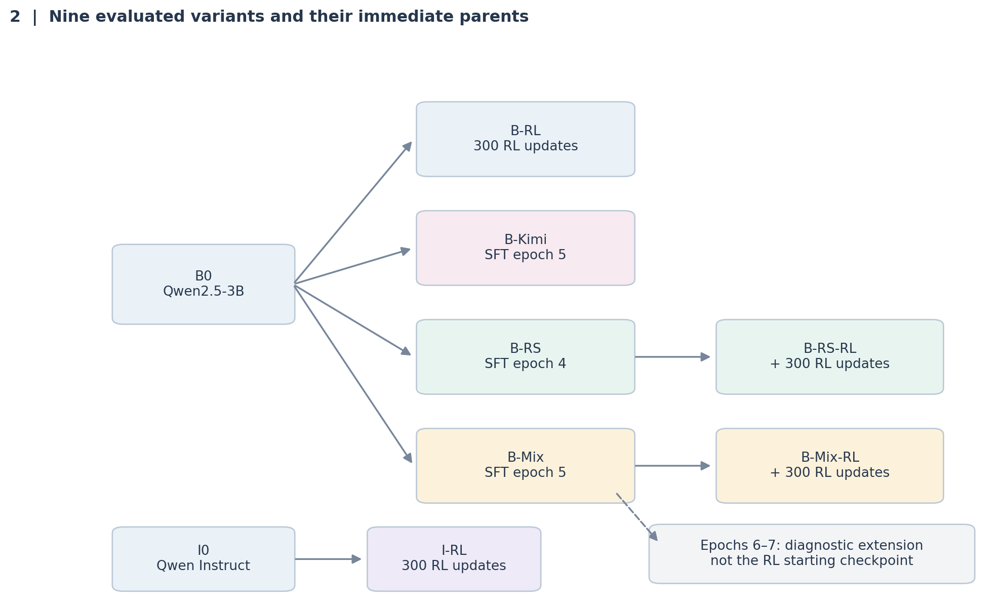
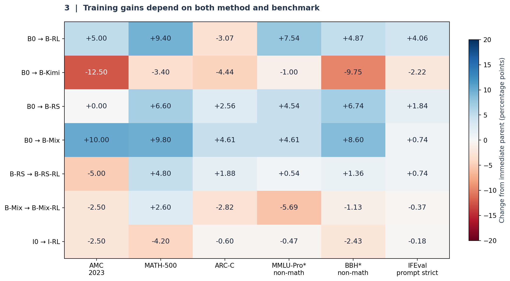

# Math Post-Training & Cross-Domain Transfer

**A nine-variant study of Qwen2.5-3B: supervised fine-tuning, rejection sampling, mixed 3B/7B distillation, and DAPO reinforcement learning.**

Can training a small language model on mathematics improve its performance beyond math? This project compares nine base- and instruct-derived checkpoints on mathematics, science, broader knowledge, logical reasoning, and instruction following. All final evaluations use **temperature 0**.

**[Full write-up](write-up.md)** · **[HTML report](write-up.html)** · **[Experiment record & checkpoint paths](progress.md)** · **[Training notebooks](#training-notebooks)** · **[Evaluation notebooks](#evaluation-notebooks)**

> **Status: completed.** Training, final evaluations, and the report are complete. The HTML report embeds all eight figures and can be downloaded and opened locally; GitHub displays the Markdown report directly.

## Key findings

- **Math improved over the pretrained base.** Mixed-data SFT + RL raised MATH-500 from **54.8% to 67.2% (+12.4 pp)**. Mixed-data SFT alone raised AMC 2023 from **37.5% to 47.5% (+10.0 pp)**. These are different selected checkpoints.
- **Math training transferred to other tasks.** Rejection and mixed-data SFT improved all four main transfer measures over base. The largest gains across base-derived variants were **+4.61 pp on ARC-Challenge**, **+7.54 pp on non-math MMLU-Pro**, and **+8.60 pp on non-math BBH**.
- **More optimization did not consistently improve evaluation.** RL rewards increased, but benchmark gains depended on the starting checkpoint. Kimi-style SFT produced much longer responses while lowering math accuracy.
- **The original instruct model remained strongest.** None of the project-trained variants surpassed it on the main math or transfer metrics.

## Experiment design



All trained students are **3B models**. “Mixed 3B/7B SFT” uses both self-generated 3B solutions and solutions from **Qwen2.5-Math-7B-Instruct**. The report abbreviates rejection SFT as **B-RS**, mixed-data SFT as **B-Mix**, and the original base/instruct models as **B0/I0**.

SFT runs use full-parameter training for five epochs; a separate mixed-data continuation explores epochs 6–7. Each RL run performs **300 optimizer updates**. Rejection epoch 4 and mixed-data epoch 5 are the selected SFT checkpoints and the parents of their respective RL runs.

## Results

All values below are accuracy percentages. **Bold** marks the best result among base-derived variants.

| Model | AMC 2023 | MATH-500 | ARC-C | MMLU-Pro¹ | BBH¹ | IFEval² |
| :--- | ---: | ---: | ---: | ---: | ---: | ---: |
| Base | 37.5 | 54.8 | 73.55 | 16.54 | 11.40 | 28.47 |
| Base + RL | 42.5 | 64.2 | 70.48 | **24.08** | 16.27 | **32.53** |
| Kimi-style SFT | 25.0 | 51.4 | 69.11 | 15.54 | 1.65 | 26.25 |
| Rejection SFT · epoch 4 | 37.5 | 61.4 | 76.11 | 21.08 | 18.14 | 30.31 |
| Mixed 3B/7B SFT · epoch 5 | **47.5** | 64.6 | **78.16** | 21.15 | **20.00** | 29.21 |
| Rejection SFT + RL | 32.5 | 66.2 | 77.99 | 21.62 | 19.50 | 31.05 |
| Mixed SFT + RL | 45.0 | **67.2** | 75.34 | 15.46 | 18.87 | 28.84 |
| Instruct | 52.5 | 70.0 | 84.90 | 41.62 | 24.29 | 60.44 |
| Instruct + RL | 50.0 | 65.8 | 84.30 | 41.15 | 21.86 | 60.26 |

¹ **Non-math subsets:** MMLU-Pro reports 1,300 non-math questions from the fixed 1,400-question subset (100 per subject, seed 42). BBH uses the project’s 19-task selection. These are custom-subset scores.

² **IFEval:** strict prompt-level accuracy. Full strict/loose and instruction-level results are in the [write-up](write-up.md).

Math evaluation covers **40 AMC 2023 + 500 MATH-500 problems per model**, with a 20,480-new-token cap. Transfer evaluation covers **7,728 prompts per model / 69,552 across all nine**, with a 4,096-new-token cap.



*Changes are measured against each model’s immediate parent. For example, mixed SFT + RL is compared with mixed SFT, not with the original base.*

Math results were checked against saved metric files; transfer scores were supplied from the completed evaluation. These are single-seed experiments with benchmark-informed checkpoint selection, unequal training data, and custom transfer subsets. The [report](write-up.md) documents the protocols, provenance, and limitations.

## Training data

| Dataset | Training examples | Unique problems | Supervised target |
| :--- | ---: | ---: | :--- |
| [Kimi-style s1](https://huggingface.co/datasets/Seungjun/dp_removed_s1K-1.1) | 989 | Not separately counted | `kimi-style-reasoning-answer` |
| [3B rejection sampling](https://huggingface.co/datasets/Seungjun/qwen2.5-3b-self-rft-math) | 28,267 | 12,863 | `response` |
| [Mixed 3B/7B solutions](https://huggingface.co/datasets/Seungjun/qwen2.5-3b-self-rft-7b-distill-math) | 37,691 | 14,853 | `response` |

The two larger datasets use answer verification, solution deduplication, difficulty-based selection, and a problem pool constructed to remove math-evaluation and RL overlap. Multiple solutions can share one problem. The Kimi-style branch uses structured final responses inspired by planning, evaluation, reflection, and exploration; it has no recorded mathematical-correctness filter.

RL uses **14,068 rows** from the pinned [processed DAPO math dataset](https://huggingface.co/datasets/Seungjun/dp_removed_DAPO-Math-17k-Processed). The [dataset creation record](progress.md#dataset-creation) and [full report](write-up.md) describe construction details and unresolved provenance questions.

## Training notebooks

These notebooks bundle their code and configurations. They save training histories, manifests, and resumable checkpoints to Google Drive.

| Experiment | Notebook |
| :--- | :--- |
| Base → Kimi-style SFT | [Train Kimi-style s1](notebooks/train_qwen25_3b_base_s1_kimi.ipynb) |
| Base → rejection SFT | [Train self-RFT · 5 epochs](notebooks/train_qwen25_3b_base_self_rft.ipynb) |
| Base → mixed 3B/7B SFT | [Train mixed-data SFT · 5 epochs](notebooks/train_qwen25_3b_base_7b_distill.ipynb) |
| Mixed-data SFT → epochs 6–7 | [Continue from epoch 5](notebooks/continue_qwen25_3b_7b_distill_epoch5_to7.ipynb) |
| Base → RL | [DAPO from base · 300 updates](notebooks/train_dapo_qwen25_3b_base.ipynb) |
| Instruct → RL | [DAPO from instruct · 300 updates](notebooks/train_dapo_qwen25_3b.ipynb) |
| Rejection SFT → RL | [DAPO from epoch 4 · 300 updates](notebooks/train_dapo_qwen25_3b_rejection_epoch4.ipynb) |
| Mixed-data SFT → RL | [DAPO from epoch 5 · 300 updates](notebooks/train_dapo_qwen25_3b_7b_distill_epoch5.ipynb) |

Rejection and mixed-data SFT evaluate AMC/MATH after every epoch. Full training settings, selected checkpoints, and exact Drive locations are recorded in [progress.md](progress.md).

## Evaluation notebooks

| Evaluation | Notebook |
| :--- | :--- |
| Base, instruct, instruct + RL · AMC/MATH | [Three-model comparison](notebooks/evaluate_qwen25_3b_base_instruct_rl_amc_math.ipynb) |
| Base + RL update 300 · AMC/MATH | [Base RL evaluation](notebooks/evaluate_qwen25_3b_base_rl_checkpoint300_amc_math.ipynb) |
| Kimi-style SFT epoch 5 · AMC/MATH | [Kimi SFT evaluation](notebooks/evaluate_qwen25_3b_s1_kimi_amc_math.ipynb) |
| Both SFT + RL models · AMC/MATH | [SFT + RL comparison](notebooks/evaluate_qwen25_3b_sft_rl_checkpoint300_amc_math.ipynb) |
| **All nine · reported transfer protocol** | **[RunPod · 2 GPUs · MMLU-Pro 100/subject](notebooks/evaluate_qwen25_3b_all9_transfer_runpod_2gpu.ipynb)** |
| All nine · full MMLU-Pro protocol | [Colab · full transfer suite](notebooks/evaluate_qwen25_3b_all9_transfer.ipynb) |

The **2-GPU RunPod notebook** matches the transfer subset reported above. The older Colab full-suite notebook evaluates more MMLU-Pro questions and produces a different protocol’s results.

### Running an experiment

1. Open the relevant notebook and read its configuration cell. Training was run on an **RTX PRO 6000 96 GB**; reported transfer evaluation used **two 96 GB RTX PRO 6000 GPUs** and a **200 GB container disk**.
2. Provide `HF_TOKEN` with the access required for the selected datasets/checkpoints. Colab uses Secrets and mounted Drive; the RunPod notebook downloads trained checkpoints through the configured Hugging Face catalog.
3. Review output folders and initialization/resume paths, then run preparation and any smoke cell before enabling the full run. Defaults retain this project’s experiment-specific paths, including the instruct RL recovery checkpoint.
4. Save or export completed results. The RunPod notebook includes Hugging Face export of inference records and result tables; the Colab notebooks write results to Drive.

**Supporting notebooks:** [Upload seven trained checkpoints to Hugging Face](notebooks/upload_qwen25_3b_7_checkpoints_to_hf.ipynb) · [Collect training logs into a ZIP](notebooks/collect_qwen_training_logs.ipynb) · [Generate Kimi-inspired s1 responses](notebooks/regenerate_s1_deepseek.ipynb)

## Report and reproducibility

The [full write-up](write-up.md) includes methods, all results, epoch trajectories, RL dynamics, response-length analysis, limitations, and references. Its eight figures are available as [PNG and SVG](docs/final-report/figures/).

Rebuild the report and charts from the included analysis snapshot:

```bash
python -m pip install -r requirements-writeup.txt
python scripts/build_final_writeup.py
```

To also re-audit the original training-log archive:

```bash
python scripts/build_final_writeup.py --archive /path/to/qwen_training_logs_20261013T145235973661Z.zip
```

| Location | Contents |
| :--- | :--- |
| [`notebooks/`](notebooks/) | Self-contained training, evaluation, and utility notebooks |
| [`configs/`](configs/) | Model/data revisions, prompts, and experiment settings |
| [`pipeline/`](pipeline/) / [`eval/`](eval/) | Shared training/data and evaluation implementations |
| [`scripts/`](scripts/) | Notebook builders and report generation |
| [`tests/`](tests/) | Preparation, training, checkpoint, and evaluation checks |
| [`docs/final-report/`](docs/final-report/) | Report template, source-attributed analysis data, and figures |
| [`progress.md`](progress.md) | Detailed experiment record and storage paths |

## Earlier experiments

The repository name reflects its original Korean/EXAONE direction. The completed study uses **English data and Qwen2.5-3B**. Earlier EXAONE, translation, and exploratory notebook documentation is preserved in the [archived README](docs/archive/README-before-final-report-2026-10-14.md) and [historical write-up](docs/archive/write-up-exaone-2026-10-03.md).
